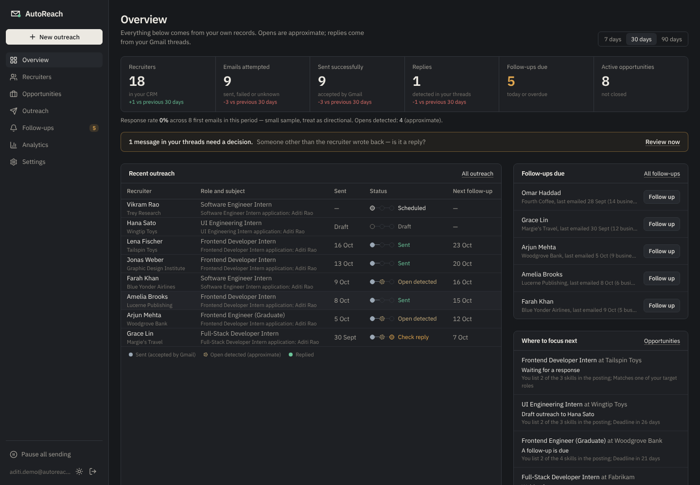

# AutoReach 2.0

A personal outreach workspace for an internship or first-job search: keep track of the
recruiters you contact and the roles you're after, write role-specific emails from your own
profile, send them from your own Gmail with your résumé attached, see replies, and get
reminded when to follow up.



*Screenshots show the real dashboard running locally with fictional demo data
(`npm run seed:demo -w @autoreach/backend`); see [docs/screenshots](docs/screenshots).*

## What it does

* **Recruiter CRM**: search, filter, tags, notes, CSV import/export, duplicate detection by
  normalised email, merges that keep history, links to job opportunities.
* **Opportunity tracker**: saved postings with skills, deadline and a status pipeline from
  "saved" to "offer".
* **Role-specific drafts**: from your verified profile, projects and the job posting, with AI
  (Anthropic, OpenAI, Gemini, Groq or any OpenAI-compatible server) or from your templates.
  A quality check flags wrong names or companies, invented facts, placeholders and repeat
  outreach before you send.
* **Sending you approve**: nothing goes out until you press Send or approve it for the queue.
  Double submissions are blocked, résumés are verified before attaching, and failures are shown
  as failures. Pause everything with one click.
* **Honest status**: sent, open detected (optional and approximate) and replied are separate.
  Replies, bounces and automatic replies are detected from Gmail message headers.
* **Follow-up reminders** a few business days later, drafted in the same thread and cancelled
  when someone replies.
* **Chrome extension**: popup, side-panel composer, a Gmail card that shows whether you've
  contacted someone, and "Add opportunity" from the page you're on.
* **Your data**: export everything, delete your account, choose how long open signals are kept.

## Repository

```
packages/shared/    types, validation, status rules, quality checks (TypeScript)
backend/            API + background jobs (Express 5, PostgreSQL via pg, TypeScript)
dashboard/          web dashboard (React 19, Vite, Tailwind)
extension/          Chrome extension, Manifest V3 (React, TypeScript)
website/            marketing site and privacy policy (separate project)
supabase/migrations SQL migrations, including the in-place upgrade of v1 data
docs/               setup, deployment, architecture, audit, test results
```

## Quick start (local, no external accounts)

```bash
npm ci && npm run build:shared
createdb autoreach
cp backend/.env.example backend/.env      # set DATABASE_URL, STORAGE_DRIVER=local,
                                          # ENABLE_DEV_LOGIN=true, DEV_JWT_SECRET, TOKEN_ENCRYPTION_KEY
ALLOW_AUTH_SHIM=true npm run db:migrate
npm run seed:demo -w @autoreach/backend   # optional fictional data
npm run dev:api                           # http://localhost:3001
VITE_DEV_LOGIN=true npm run dev:dashboard # http://localhost:5173
```

Full instructions: [docs/SETUP.md](docs/SETUP.md).

## Documentation

| Topic | Document |
|---|---|
| Local setup | [docs/SETUP.md](docs/SETUP.md) |
| Gmail and Google sign-in | [docs/GMAIL_OAUTH.md](docs/GMAIL_OAUTH.md) |
| AI providers | [docs/AI_PROVIDERS.md](docs/AI_PROVIDERS.md) |
| Chrome extension | [docs/EXTENSION.md](docs/EXTENSION.md) |
| Deployment (Supabase, Railway, Vercel) and upgrading from v1 | [docs/DEPLOYMENT.md](docs/DEPLOYMENT.md) |
| Troubleshooting and error codes | [docs/TROUBLESHOOTING.md](docs/TROUBLESHOOTING.md) |
| What changed from v1, deferred work, limitations | [docs/RELEASE_NOTES_2.0.md](docs/RELEASE_NOTES_2.0.md) |
| Architecture and data model | [docs/ARCHITECTURE.md](docs/ARCHITECTURE.md) |
| v1 audit | [docs/REPOSITORY_AUDIT.md](docs/REPOSITORY_AUDIT.md) |
| Tests and results | [docs/TEST_RESULTS.md](docs/TEST_RESULTS.md) |

## Checks

```bash
npm run check   # typecheck, lint, tests (incl. PostgreSQL integration tests), production builds
```

## Upgrading from v1

The migrations upgrade the v1 tables in place and keep every recruiter, email record,
template and Gmail connection. **Back up the database first** and deploy the 2.0 API right
after migrating: the v1 API doesn't work with the upgraded schema. Steps:
[docs/DEPLOYMENT.md](docs/DEPLOYMENT.md).
